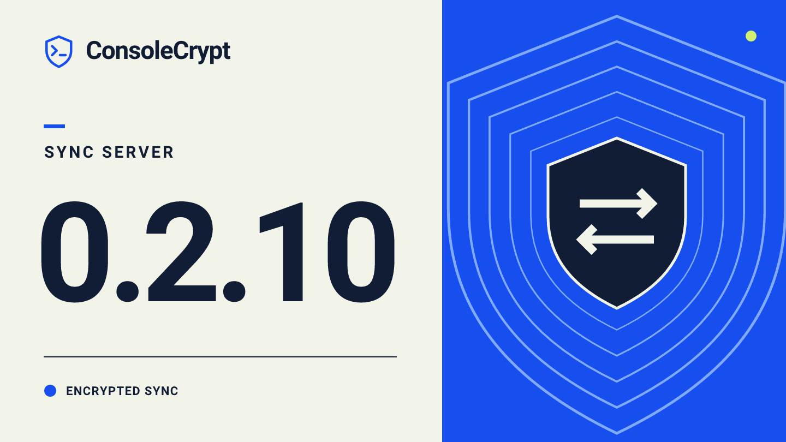

# ConsoleCrypt Sync Server 0.2.10

## Русский

Исправлен преждевременный отказ при выдаче ключевого материала новым устройствам в первый час после полуночи UTC. Одна выдача теперь учитывается один раз в часовом и суточном лимитах. Действующие лимиты сохраняются при обновлении.

Выпуск для ConsoleCrypt 1.2.1. Подключение к HashiCorp Vault или OpenBao синхронизируется между доверенными устройствами как зашифрованная запись личного хранилища. Пароль или токен передаётся, если владелец включил эту опцию для подключения. Значения секретов клиент читает непосредственно из Vault или OpenBao.

Добавлена проверка жизненного цикла подключения с двумя устройствами и PostgreSQL. При отключении синхронизации реквизитов второе устройство получает удаление записей входа. Само подключение остаётся доступным. Сервер использует протокол 1.13 и существующую схему PostgreSQL из версии 0.2.8. [Инструкция по обновлению](https://consolecrypt.dev/guide#server-docker).

## English

New devices could reach the unlock-material limit too early in the first hour after midnight UTC. Each issuance now counts once toward each hourly and daily limit. Upgrading preserves the counters already in use.

This release accompanies ConsoleCrypt 1.2.1. Trusted devices sync HashiCorp Vault and OpenBao connections as encrypted records in the personal vault. The owner can opt in to syncing a password or token for each connection. The client reads secret values directly from Vault or OpenBao.

A new two-device PostgreSQL test covers the connection lifecycle. When credential sync is turned off, the second device receives deletions for the login records and keeps the connection. The server uses protocol 1.13 and the existing PostgreSQL schema from 0.2.8. [Upgrade guide](https://consolecrypt.dev/guide#server-docker).

## Español

Los dispositivos nuevos podían alcanzar antes de tiempo el límite de entregas de material de desbloqueo durante la primera hora después de la medianoche UTC. Cada entrega cuenta ahora una vez para el límite por hora y una vez para el límite diario. La actualización conserva los contadores en uso.

Esta versión acompaña a ConsoleCrypt 1.2.1. Los dispositivos de confianza sincronizan las conexiones a HashiCorp Vault y OpenBao como registros cifrados de la bóveda personal. El propietario puede activar la sincronización de la contraseña o del token para cada conexión. El cliente lee los valores de los secretos directamente de Vault u OpenBao.

Una nueva prueba con dos dispositivos y PostgreSQL cubre el ciclo de vida de una conexión. Al desactivar la sincronización de credenciales, el segundo dispositivo recibe la orden de eliminar los registros de acceso y conserva la conexión. El servidor utiliza el protocolo 1.13 y el esquema de PostgreSQL de la versión 0.2.8. [Guía de actualización](https://consolecrypt.dev/guide#server-docker).

## 简体中文

已修复 UTC 零点后一小时内新设备过早触发解锁材料发放限制的问题。现在每次发放只会在每小时和每日额度中各计一次。升级会保留已有的计数记录。

此版本配合 ConsoleCrypt 1.2.1 发布。受信任的设备可以通过个人保险库同步 HashiCorp Vault 或 OpenBao 的加密连接记录。用户可为每个连接单独选择是否同步密码或令牌。客户端直接从 Vault 或 OpenBao 读取密钥值。

新增了使用 PostgreSQL 和两台设备的连接生命周期测试。关闭凭据同步后，第二台设备会收到登录记录的删除标记，同时保留连接配置。服务器使用协议 1.13，沿用 0.2.8 的 PostgreSQL 数据库结构。[升级指南](https://consolecrypt.dev/guide#server-docker)。
